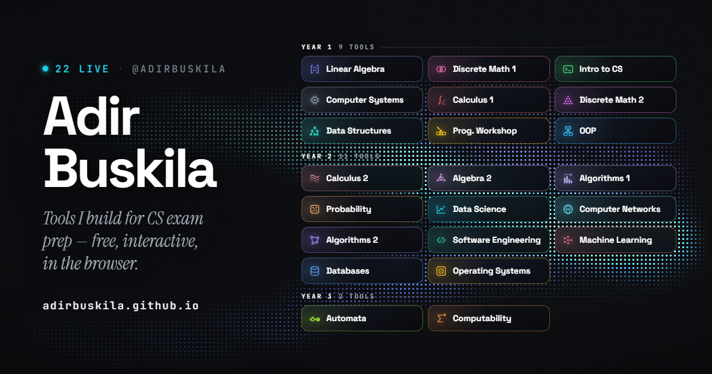

# CS Study Tools Deck

[](https://adirbuskila.github.io/)

Personal launch hub for the exam-prep web apps I build for computer-science students.
One shareable URL instead of one link at a time: **https://adirbuskila.github.io/**

Hand-rolled static site — no framework, no build step, no dependencies.

## The look

The background is a live WebGL "signal": ribbons of light resolved through a
7px LED dot matrix, ported to dependency-free WebGL in [`signal.js`](signal.js)
from ThreeUI's *Ribbon Field* ([MengTo/threeui](https://github.com/MengTo/threeui), MIT)
and extended so the page reacts to what you hover — the ribbons re-tint to that
subject's accent and a bloom drifts behind the tile. Tiles are frosted glass over
it with a shared pointer spotlight on their borders.

- No WebGL → `html.no-signal`, falls back to the CSS backdrop.
- `prefers-reduced-motion` → one static frame, no CSS motion.
- Pointer/tilt/spotlight only run on `(hover: hover) and (pointer: fine)`.
- Layering gotcha: the canvas sits at `z-index: 0` under `.page { z-index: 1 }`,
  *not* at a negative z-index — Chrome leaves negative-z root layers out of the
  backdrop that `backdrop-filter` samples, so the glass would stop blurring it.

## Launching a new tool

Everything is driven by the `tools` array at the top of [`app.js`](app.js).
The array is ordered chronologically through the degree. Every entry has a
`year` (1-3) and, for years 1-2, a `sem` (`'A'` or `'B'`); the page builds one
section per year/semester ("YEAR 1 · SEMESTER A", "YEAR 3") in array order, so
put a new course in the right spot. Within a section, live tools render first as
full glass tiles, then the BUILDING cards. The header counter ("N LIVE · M
BUILDING") and the star section (same order, "This deck" last) are computed
from the same array.

Courses still being built are `status: 'soon'` entries with just `subject`,
`glyph`, `nameHe`, `year`, `sem` and `accent`. To launch one, edit its entry:

```js
status: 'soon',  →  status: 'live',
```

and add `tag`, `blurb`, `url` and `repo` (drop `nameHe`; the glyph is already
set, or add a new one to the `glyphs` map). It keeps its year/semester section;
the compact card just becomes a full tile. No CSS changes are needed: live tiles
use a uniform 1 / 2 / 3 column grid and BUILDING cards a matching one.

## Run locally

Double-clicking `index.html` works (no fetch calls), or serve it:

```
python -m http.server 8000
# → http://localhost:8000
```

## Deploy (GitHub Pages, user site root)

```
git init -b main
git add -A
git commit -m "CS study tools deck"
git remote add origin https://github.com/AdirBuskila/adirbuskila.github.io.git
git push -u origin main
```

The repo **must be named exactly `adirbuskila.github.io`** — GitHub then serves it
at the root URL automatically (check Settings → Pages shows "main / root" if it
doesn't appear within a minute). Existing project pages
(`/data-science-quiz/`, `/os-exam-trainer/`) live in their own repos and are unaffected.

## Regenerating the OG image

`og.png` (the link-preview card) is a 1200×630 screenshot of `og-template.html`:

```
& "C:\Program Files\Google\Chrome\Application\chrome.exe" --headless=new --disable-gpu `
  --enable-unsafe-swiftshader --force-prefers-reduced-motion `
  --hide-scrollbars --window-size=1200,630 --virtual-time-budget=9000 `
  --screenshot="og.png" "file:///$PWD/og-template.html".Replace('\','/')
```

`--enable-unsafe-swiftshader` gives headless Chrome a WebGL context for the
signal background; `--force-prefers-reduced-motion` makes `signal.js` draw one
deterministic frame instead of running its rAF loop (which would otherwise eat
the virtual-time budget and freeze CSS animations at frame 0).

The card loads `app.js` and builds its tiles and LIVE count from the `tools`
array, grouped by year, so after launching a course just re-run and commit.
Over-long names get a short label in the template's `SHORT` map. Note: OG images are cached hard by
WhatsApp/LinkedIn — use their debuggers (e.g. LinkedIn Post Inspector) to bust it.
